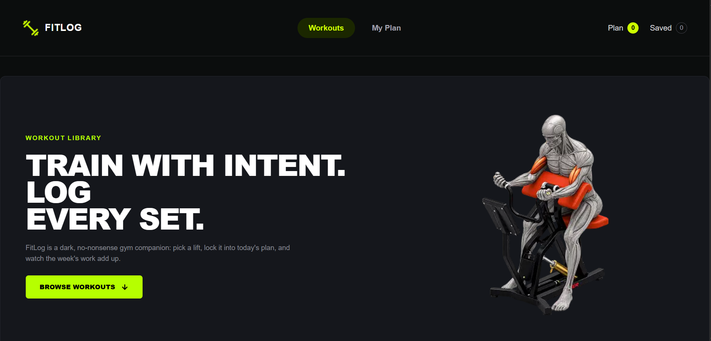

# FitLog

FitLog is a modern workout library that helps users explore different exercises, view workout details, and organize their personal workout plans.

## 📸 Project Screenshot


## 🌐 Live Demo

[Visit FitLog Website](https://assignment-6-next-js-omega.vercel.app/)
## ⚙️ Installation Instructions

1. Clone the repository:

```bash
git clone https://github.com/swagatamondalahona/assignment-6-next-js.git


## Technologies Used

- Next.js
- React
- JavaScript
- Tailwind CSS
- DaisyUI
- REST API

## Key Features

1. **Workout Library**  
   Explore a collection of different workouts and exercises.

2. **Workout Details**  
   View detailed information about individual workouts.

3. **Search & Explore**  
   Easily find workouts from the workout library.

4. **Personal Workout Plan**  
   Add workouts to a personal plan and organize training activities.

5. **Save Workouts**  
   Save favorite workouts for quick access later.
